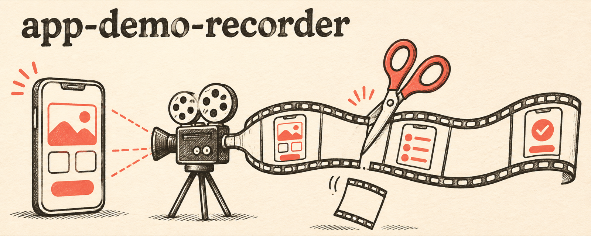

<p align="center">
  
</p>

<p align="center">
  <a href="README.md">English</a> · <b>한국어</b>
</p>

# app-demo-recorder

**코딩 에이전트가 앱을 직접 조작해, 앱을 잘 아는 사람이 쓰는 것 같은 데모 영상을 찍어 줍니다.**

## 무엇인가

[Claude Code](https://claude.com/claude-code)와 [Codex](https://github.com/openai/codex)용 에이전트 스킬입니다. 에이전트가 Android 에뮬레이터나 iOS 시뮬레이터에서 앱을 조작하면서 기능마다 클립을 하나씩 녹화합니다. 기다리는 시간은 잘라 내고, 클립마다 제대로 찍혔는지 확인합니다. 결과물은 광고, 스토어 미리보기, SNS 게시물, 화면 녹화를 입력으로 받는 AI 영상 도구에 바로 쓸 수 있습니다.

## 왜 만들었나

에이전트에게 앱 녹화를 맡기면 로봇이 쓰는 것처럼 보입니다. 탭과 탭 사이에 에이전트가 화면을 확인하느라 길게 멈추고, 에뮬레이터는 버벅입니다. 디버그 토스트, 테스트 데이터, 광고도 함께 찍히고 상태바에는 3:17과 바닥난 배터리가 보입니다. Android 에뮬레이터에서는 기기 안 `adb shell screenrecord`가 React Native 화면을 멈춰 버려서, 스크롤과 탭이 영상에 아예 안 남기도 합니다.

## 하는 일

| 문제 | 스킬이 하는 일 |
| --- | --- |
| 탭 사이, 화면 로딩 중 멈춰 있는 시간 | `tighten`이 ffmpeg `freezedetect`로 멈춘 구간을 찾아 0.35초로 줄입니다. 첫 탭 전의 빈 시작 구간도 잘라 내고, 마지막 결과 화면은 읽을 수 있게 1.5초 남깁니다. |
| Android 녹화에서 스크롤과 탭이 사라짐 | 기기 안이 아니라 호스트에서 `adb emu screenrecord`로 녹화합니다 |
| 버벅이는 에뮬레이터 | 메모리와 코어를 늘리고 호스트 GPU로 AVD를 띄웁니다 |
| 지저분한 상태바 | Android 데모 모드와 `simctl status_bar`로 시간 고정, 배터리·신호 가득, 알림 아이콘 숨김 |
| 조작이 조용히 실패함 | `strip`이 프레임을 고르게 뽑아 가로로 붙여서 모든 단계를 확인할 수 있게 합니다 |
| 디버그 빌드, 테스트 데이터, 광고가 찍힘 | 릴리스 빌드, 실제 계정, 광고 없는 상태를 먼저 정하고, 촬영용으로 만든 데이터는 바로 지웁니다 |

## 예시

스크롤 두 번을 담은 Android 테스트 녹화 9초의 실제 결과입니다.

```text
$ appdemo.sh stop t_android
app-demo-clips/t_android.mp4  9.3s
$ appdemo.sh tighten app-demo-clips/t_android.mp4 app-demo-clips/t_android_tight.mp4
app-demo-clips/t_android_tight.mp4: 9.3s -> 3.9s (3 waits shortened, idle lead-in 2.7s cut)
```

기능별로 클립 7개를 찍은 실제 작업에서는 `tighten`이 클립 길이를 절반 아래로 줄였습니다. 20.4초는 9.9초, 18.2초는 3.8초, 28.9초는 13.2초가 됐습니다.

## 필요한 것

- macOS와 `ffmpeg` (`brew install ffmpeg`)
- Android: Android SDK(`adb`, `emulator`)와 실행 중인 에뮬레이터
- iOS: Xcode 커맨드라인 도구와 부팅된 시뮬레이터

## 설치

### Claude Code 플러그인

```
/plugin marketplace add nathankim0/app-demo-recorder
/plugin install app-demo-recorder@app-demo-recorder
```

### Claude Code·Codex 개인 스킬 (심볼릭 링크, `git pull`로 업데이트)

```bash
git clone https://github.com/nathankim0/app-demo-recorder ~/app-demo-recorder
~/app-demo-recorder/install.sh          # or: install.sh claude | install.sh codex
brew install ffmpeg
```

## 사용법

에이전트에게 이렇게 요청하면 됩니다. "Android 에뮬레이터에서 검색이랑 결제 화면 데모 영상 찍어줘". Codex에서는 `$app-demo-recorder`로 직접 부를 수도 있습니다.

스크립트만 따로 써도 됩니다.

```bash
S=skills/app-demo-recorder/scripts/appdemo.sh
export APPDEMO_OUT=~/Desktop/clips          # default: ./app-demo-clips

$S devices                                  # running emulators and booted simulators
$S statusbar on                             # 9:41, full battery, no notifications (APPDEMO_TIME to change)
$S start 01_search
#   drive the app: adb shell input, xcrun simctl, or your UI automation tool
$S stop 01_search                           # -> $APPDEMO_OUT/01_search.mp4
$S tighten $APPDEMO_OUT/01_search.mp4 $APPDEMO_OUT/01_search_tight.mp4
$S strip   $APPDEMO_OUT/01_search_tight.mp4 /tmp/01.jpg 8
$S speed   $APPDEMO_OUT/01_search.mp4 $APPDEMO_OUT/01_search_fast.mp4 1.3
$S statusbar off
```

Android 에뮬레이터와 iOS 시뮬레이터가 둘 다 켜져 있으면 `APPDEMO_PLATFORM=android|ios`를 지정하세요. 같은 종류의 기기가 여러 대 켜져 있으면 `APPDEMO_DEVICE`도 지정합니다.

`tighten.py` 옵션은 `--hold`(남길 대기 길이, 기본 0.35초), `--last-hold`(1.5초), `--min-freeze`(0.45초), `--noise`(0.0004), `--lead`(첫 조작 전에 남길 시간, 0.4초), `--action-scene`(0.05)입니다. 숫자 입력처럼 작은 변화가 잘려 나가면 `--noise`를 낮추세요.

## 저장소 구조

```text
skills/app-demo-recorder/SKILL.md            workflow the agent follows
skills/app-demo-recorder/scripts/appdemo.sh  devices, statusbar, start/stop, tighten, speed, strip
skills/app-demo-recorder/scripts/tighten.py  cuts frozen stretches with ffmpeg freezedetect
skills/app-demo-recorder/agents/openai.yaml  Codex display metadata
.claude-plugin/                              plugin and marketplace manifests
install.sh                                   symlink installer for Claude Code and Codex
```

## 라이선스

MIT
