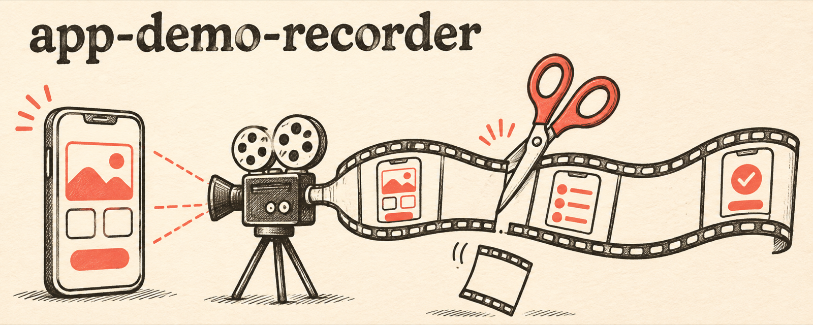

<p align="center">
  
</p>

<p align="center">
  <b>English</b> · <a href="README.ko.md">한국어</a>
</p>

# app-demo-recorder

**Demo clips of your mobile app that look like a person who knows the app is using it, recorded by your coding agent.**

## What it is

An agent skill for [Claude Code](https://claude.com/claude-code) and [Codex](https://github.com/openai/codex). The agent drives your app on an Android emulator or iOS simulator, records one clip per feature, cuts the waiting, and checks every clip. Use the clips in ads, store previews, social posts, or AI video tools that take a screen recording as input.

## Why it exists

When an agent records an app, the clips look like a robot used it. There are long pauses while the agent inspects the screen between taps, and the emulator stutters. The shot also picks up debug toasts, test data, ads, and a status bar showing 3:17 with a low battery. On an Android emulator, in-device `adb shell screenrecord` can even freeze a React Native UI, so scrolls and taps never show up in the file.

## What it does

| Problem | What the skill does |
| --- | --- |
| Dead time between taps and while screens load | `tighten` finds frozen stretches with ffmpeg `freezedetect` and cuts each one to 0.35 s. The idle lead-in before the first tap is cut, and the final result screen keeps 1.5 s so viewers can read it. |
| Scrolls and taps missing from Android recordings | Records on the host with `adb emu screenrecord`, not in the device |
| Choppy emulator | Boots the AVD with more memory, more cores and the host GPU |
| Messy status bar | Android demo mode and `simctl status_bar`: fixed time, full battery and signal, no notification icons |
| An action silently did nothing | `strip` puts evenly spaced frames side by side so every step can be checked |
| Debug builds, test data, ads in the shot | The agent agrees on a release build, a real account and an ad-free state first, and deletes any data it creates for a shot |

## Example

A real 9-second Android test take with two scrolls:

```text
$ appdemo.sh stop t_android
app-demo-clips/t_android.mp4  9.3s
$ appdemo.sh tighten app-demo-clips/t_android.mp4 app-demo-clips/t_android_tight.mp4
app-demo-clips/t_android_tight.mp4: 9.3s -> 3.9s (3 waits shortened, idle lead-in 2.7s cut)
```

On a real seven-clip recording session (one feature per clip), `tighten` shortened the clips to less than half their length: 20.4 s to 9.9 s, 18.2 s to 3.8 s, and 28.9 s to 13.2 s.

## Requirements

- macOS with `ffmpeg` (`brew install ffmpeg`)
- Android: Android SDK (`adb`, `emulator`) and a running emulator
- iOS: Xcode command line tools and a booted simulator

## Install

### As a Claude Code plugin

```
/plugin marketplace add nathankim0/app-demo-recorder
/plugin install app-demo-recorder@app-demo-recorder
```

### As a personal skill for Claude Code and Codex (symlink, updates with `git pull`)

```bash
git clone https://github.com/nathankim0/app-demo-recorder ~/app-demo-recorder
~/app-demo-recorder/install.sh          # or: install.sh claude | install.sh codex
brew install ffmpeg
```

## Usage

Ask the agent, for example: "record a demo of the search and checkout screens on the Android emulator". In Codex you can call it explicitly with `$app-demo-recorder`.

The script also works on its own:

```bash
S=skills/app-demo-recorder/scripts/appdemo.sh
export APPDEMO_OUT=~/Desktop/clips          # default: ./app-demo-clips

$S devices                                  # running emulators and booted simulators
$S statusbar on                             # 9:41, full battery, no notifications (APPDEMO_TIME to change)
$S start 01_search
#   drive the app: adb shell input, xcrun simctl, or your UI automation tool
$S stop 01_search                           # -> $APPDEMO_OUT/01_search.mp4
$S tighten $APPDEMO_OUT/01_search.mp4 $APPDEMO_OUT/01_search_tight.mp4
$S strip   $APPDEMO_OUT/01_search_tight.mp4 /tmp/01.jpg 8
$S speed   $APPDEMO_OUT/01_search.mp4 $APPDEMO_OUT/01_search_fast.mp4 1.3
$S statusbar off
```

When an Android emulator and an iOS simulator are both running, set `APPDEMO_PLATFORM=android|ios`. Set `APPDEMO_DEVICE` when more than one device of that kind is running.

`tighten.py` options: `--hold` (kept length of each wait, default 0.35 s), `--last-hold` (1.5 s), `--min-freeze` (0.45 s), `--noise` (0.0004), `--lead` (time kept before the first action, 0.4 s), `--action-scene` (0.05). If a small change such as typing a digit gets cut, lower `--noise`.

## Repository layout

```text
skills/app-demo-recorder/SKILL.md            workflow the agent follows
skills/app-demo-recorder/scripts/appdemo.sh  devices, statusbar, start/stop, tighten, speed, strip
skills/app-demo-recorder/scripts/tighten.py  cuts frozen stretches with ffmpeg freezedetect
skills/app-demo-recorder/agents/openai.yaml  Codex display metadata
.claude-plugin/                              plugin and marketplace manifests
install.sh                                   symlink installer for Claude Code and Codex
```

## License

MIT
